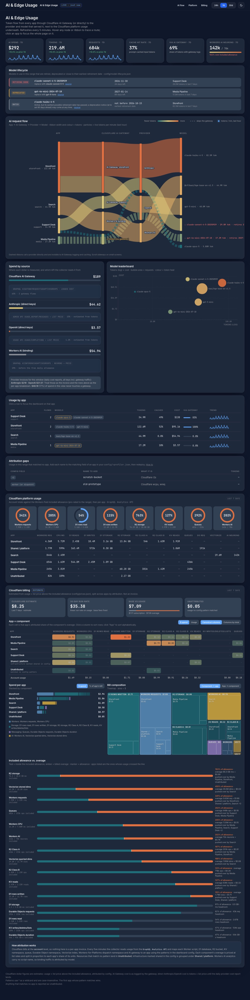
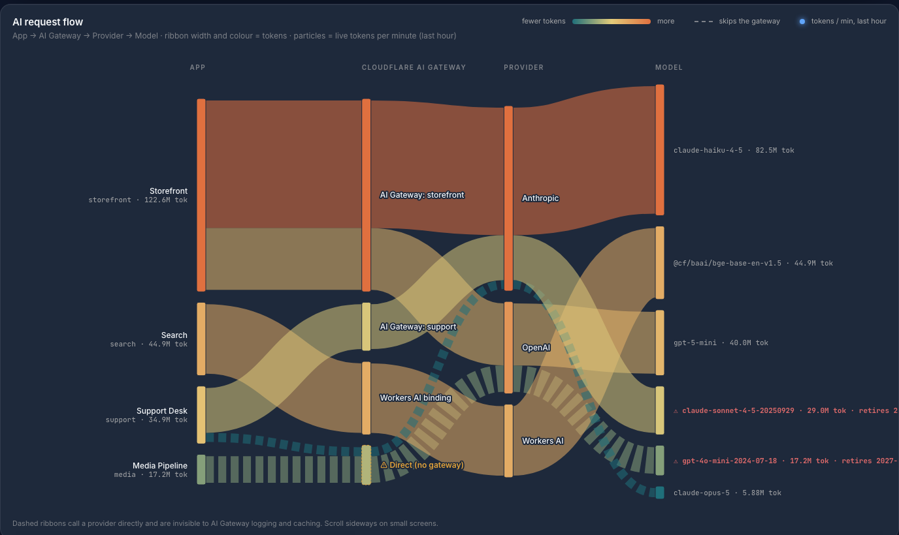
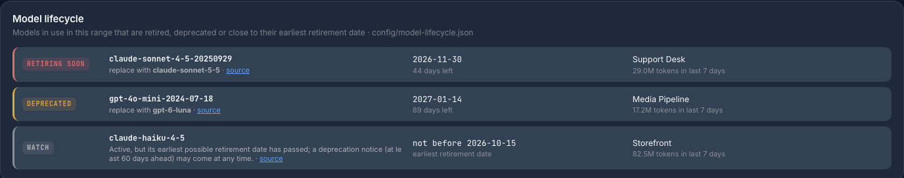
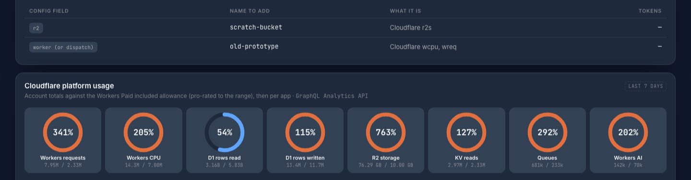
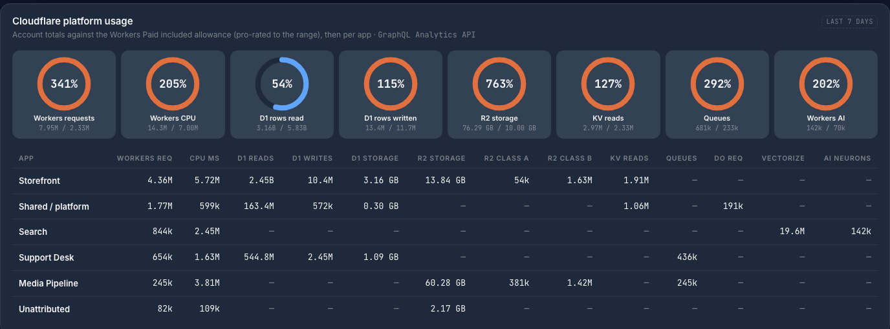
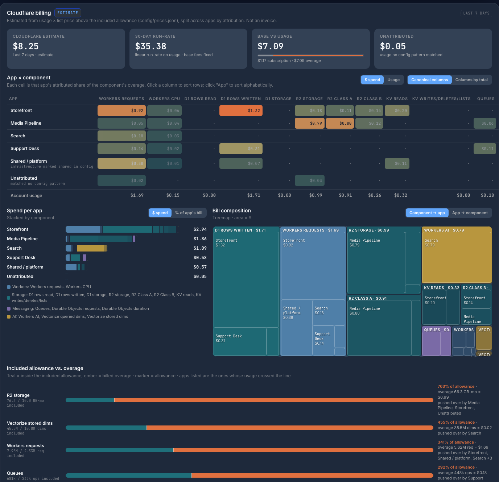
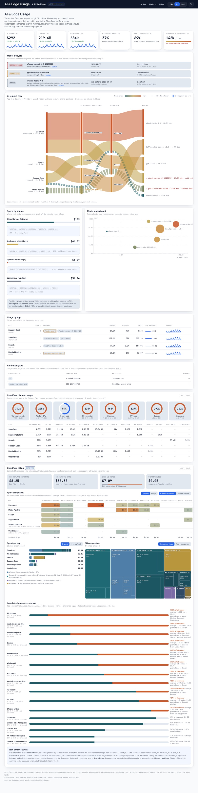
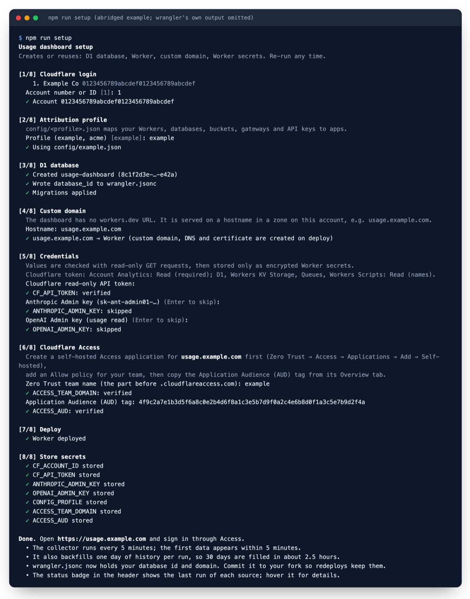
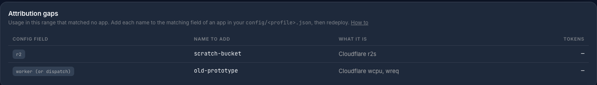

# Cloudflare AI Usage Dashboard

[](https://deploy.workers.cloudflare.com/?url=https://github.com/WeaveHubHQ/cloudflare-ai-usage-dashboard)

See where your AI tokens and Cloudflare bill go, per app, refreshed every 5 minutes.

A single Cloudflare Worker collects usage from Cloudflare (Workers, D1, R2, KV, Queues, Durable Objects, Vectorize, Workers AI, AI Gateway), Anthropic and OpenAI. It attributes every resource to one of your apps using a config file, and serves an animated dashboard behind Cloudflare Access.



<sub>Screenshots use the bundled demo data (`npm run demo`), not a real account.</sub>

## What you get

**AI request flow.** Every app → AI Gateway (or direct to the provider, or the Workers AI binding) → provider → model. Ribbon width and colour show tokens for the selected range. The moving particles are **live**: their speed and density show tokens per minute over the last hour, and a flow that has been idle for the last hour has none. Dashed ribbons skip the gateway, so they never appear in gateway logs. Hover a ribbon to trace a route, or click an app to focus the whole page on it.



**Model lifecycle callout.** If a model you used in the selected range is retired, deprecated or past its earliest retirement date, a card under the KPIs lists it with the retirement date, days left, the vendor's recommended replacement, the apps still using it, and a link to the vendor notice. Those models are also marked ⚠ in the flow graph and its tooltips. Dates come from `config/model-lifecycle.json`, built from the Anthropic, OpenAI and Workers AI deprecation pages; update it when vendors announce changes. A deprecated model within 60 days of retirement is shown as **Retiring soon**.



**KPIs with trends.** AI spend, tokens and requests compared with the previous period, plus cache hit rate, the share of traffic that goes through a gateway, and Workers AI neurons against the free allowance.



**Cloudflare platform usage.** Account totals against the Workers Paid included allowance, pro-rated to the selected range, then broken down by app.



**Cloudflare billing estimate.** Usage × list price above the included allowance, split across apps in proportion to their share of each component. The page shows it as an app × component matrix (switch between **$ spend** and **Usage**: units per app and their share of each component, which is the useful view while you're inside the allowance; it opens on Usage until the overage estimate reaches $1), a stacked spend bar per app, a treemap of the bill, and which apps pushed each component over its allowance. Cloudflare invoices the account, not apps, so this is an **estimate** and is labelled as one everywhere.



Light and dark themes follow the system setting; the moon/sun button switches them. The default palette is neutral. Set `"theme": "navy-gold"` in a profile for a navy and gold preset.

<details><summary>Light theme</summary>



</details>

## Try it without any tokens

```bash
npm install
npm run demo        # seeds 30 days of fictional data, then serves http://localhost:8787
```

The demo uses its own local state (`.wrangler/demo`), so it never touches real data.

## Deploy

You need a Cloudflare account on **Workers Paid** (for cron triggers and D1) with a domain (zone) on that account, and **Cloudflare Zero Trust** (the free plan is enough) for Access.

There are two ways to deploy. Both end with the same Worker, a D1 database, a 5-minute cron, and every credential stored as an encrypted Worker secret.

| | Deploy to Cloudflare button | `npm run setup` |
|---|---|---|
| Creates the D1 database and runs migrations | ✓ | ✓ |
| Prompts for tokens and stores them as secrets | ✓ (not checked) | ✓ (each one checked against its API first) |
| Copies the repo into your GitHub account and redeploys on every push | ✓ | — |
| Attaches the custom domain | Manual (step 4) | ✓ |
| Stores the Cloudflare Access settings | Manual (step 4) | ✓ |
| Requires | This repo to be **public** | Node 18+ and a local clone |

Before either path, prepare the credentials (steps 1 to 3) and create the Access application (step 4).

### 1. Create a read-only Cloudflare API token

Cloudflare dashboard → **My Profile** → **API Tokens** → **Create Token** → **Create Custom Token**.

- **Token name:** `usage-dashboard (read-only)`
- **Permissions:** all **Account**-level, all **Read**:

  | Permission | Used for | Required? |
  |---|---|---|
  | Account Analytics: Read | All usage numbers (GraphQL Analytics API, including AI Gateway and Workers AI) | **Yes** |
  | D1: Read | Show D1 databases by name instead of ID | Recommended |
  | Workers KV Storage: Read | Show KV namespaces by name | Recommended |
  | Queues: Read | Show queues by name | Recommended |
  | Workers Scripts: Read | Map Durable Object namespaces to their Worker | Recommended |

- **Account Resources:** *Include* → only the account this dashboard reports on.
- **Zone Resources:** none. No Edit permission is needed anywhere.

Without the recommended permissions everything still works, but those resources show (and match config patterns) by ID instead of name.

You will also need your **Account ID**: Cloudflare dashboard → account home → right-hand sidebar → *Account ID*.

### 2. (Optional) Create an Anthropic Admin key

Only needed if any app calls the Claude API **directly**. Traffic through an AI Gateway is already counted from gateway analytics.

Claude Console → **Settings** → **Admin keys** → **Create admin key** (`sk-ant-admin01-…`).

> **The Admin API is unavailable for individual Console accounts**, which return `403`. You do not need Enterprise, but your account must be set up as an **organization** (Console → [Settings → Organization](https://platform.claude.com/settings/organization)), and only members with the admin role can create Admin keys. A regular `sk-ant-api03-…` key is rejected as well.

> Anthropic admin keys have **no selectable scopes**; there is no read-only option. The collector only ever calls GET endpoints (`usage_report/messages`, `cost_report`, `api_keys`). Treat the key as highly privileged, keep it only as a Worker secret, and rotate it if it is ever exposed.

### 3. (Optional) Create an OpenAI Admin key

Only needed for direct OpenAI calls. OpenAI dashboard → **Organization settings** → **Admin keys** → **Create new admin key**. If your organization offers restricted admin keys, allow only **Usage: Read** (and **Projects: Read** to show project names).

### 4. Protect it with Cloudflare Access

The dashboard shows spend for every app, so it is never public. Pick a hostname on a zone in the same account, e.g. `usage.example.com`.

1. **Zero Trust** → **Access** → **Applications** → **Add an application** → **Self-hosted**.
2. **Application name:** `Usage dashboard`. **Session duration:** your choice. **Public hostname:** `usage.example.com`.
3. Add a policy: **Action** *Allow*, with **Include** set to the emails or group that should see it.
4. Save, open the application, and copy the **Application Audience (AUD) Tag** from the *Overview* tab (64 hex characters).
5. Note your **team name**: the part before `.cloudflareaccess.com` in your team domain, shown under Zero Trust → **Settings**.

The Worker checks the Access JWT on every request, including static files. Until both Access settings are stored it answers **503 "Cloudflare Access is not configured yet"**, so a half-finished deploy never leaks data. It has no `workers.dev` or preview URL, so it cannot be reached around Access.

### 5a. Deploy with the button

Click **Deploy to Cloudflare** at the top of this page (the repo must be public). Cloudflare:

1. copies the repo into your GitHub account and connects Workers Builds, so every push redeploys;
2. creates the `usage-dashboard` D1 database and runs the migrations as part of `npm run deploy`;
3. prompts for `CF_ACCOUNT_ID`, `CF_API_TOKEN`, `ANTHROPIC_ADMIN_KEY`, `OPENAI_ADMIN_KEY` (enter `none` for the optional keys) and `CONFIG_PROFILE` (start with `example`), and stores them as secrets.

Then finish in the Cloudflare dashboard → **Workers & Pages** → `usage-dashboard`:

- **Settings** → **Domains & Routes** → **Add** → **Custom domain** → `usage.example.com`.
- **Settings** → **Variables and Secrets** → **Add** → type **Secret**: `ACCESS_TEAM_DOMAIN` = `<team>.cloudflareaccess.com`, and `ACCESS_AUD` = the AUD tag. Deploy.

### 5b. Deploy with the setup walkthrough

```bash
git clone https://github.com/WeaveHubHQ/cloudflare-ai-usage-dashboard.git
cd cloudflare-ai-usage-dashboard
npm install
npm run setup
```



<sub>An abridged example run with placeholder account values; wrangler's own migration and deploy output is omitted.</sub>

`npm run setup` runs eight steps:

1. **Login.** Runs `wrangler login` if needed, then asks which account to use.
2. **Profile.** Asks which `config/<profile>.json` maps your resources to apps.
3. **Database.** Creates the `usage-dashboard` D1 database (or reuses it), writes its id into `wrangler.jsonc`, and applies the migrations.
4. **Domain.** Adds your hostname to `wrangler.jsonc` as a custom domain. DNS and the certificate are created on deploy.
5. **Credentials.** Asks for each token with hidden input and checks it with read-only GET requests. Bad tokens are rejected with the reason; missing optional permissions are listed as warnings.
6. **Access.** Asks for your Zero Trust team (it checks the team's signing keys exist) and the application's AUD tag.
7. **Deploy.** Runs `wrangler deploy`.
8. **Secrets.** Stores every value with `wrangler secret put`. They never touch disk unless you also ask for a local `.dev.vars` (git-ignored, mode 600).

It is safe to re-run. Existing resources are reused, and pressing Enter at a credential prompt keeps the value already stored. To rehearse it without creating or storing anything, run `npm run setup -- --dry-run`.

Commit the updated `wrangler.jsonc` (database id and domain) to your copy so later deploys keep them.

### 6. Open it

Go to `https://usage.example.com` and sign in through Access.

- The first data appears within 5 minutes.
- Each cron run also backfills one more day of history, so the 30-day view fills in about 2.5 hours.
- The badge next to the title shows freshness (`LIVE · 2m ago`). Hover it to see the last run of every source and any error message.

## Map your resources to apps

Edit `config/example.json` (or copy it to `config/<you>.json` and register the new file in `src/config.ts`). Each app lists name patterns per resource type. `*` is a wildcard, matching is case-insensitive, and **the first app that matches wins**, so list specific apps before broad shared patterns:

```json
{ "id": "storefront", "name": "Storefront", "match": {
    "worker": ["storefront-*"],            "d1": ["storefront-*"],
    "r2": ["storefront-*"],                "kv": ["storefront-*"],
    "queue": ["storefront-*"],             "vectorize": ["storefront-*"],
    "dispatch": ["storefront"],            "gateway": ["storefront"],
    "workers_ai_model": ["@cf/meta/*"],
    "anthropic_key": ["storefront-prod"],  "anthropic_workspace": ["wrkspc_…"],
    "openai_key": ["key_…"],               "openai_project": ["Storefront"] } }
```

| Field | Matches |
|---|---|
| `worker` | Worker script name (also Durable Objects, by the Worker that defines them) |
| `d1`, `kv`, `queue` | Database, namespace and queue **names** (IDs if the token lacks the name permissions) |
| `r2`, `vectorize` | Bucket and index names |
| `dispatch` | Workers for Platforms dispatch namespace, for user Workers |
| `gateway` | AI Gateway id. Also add it to the top-level `gateways` list, which is what the collector reads. |
| `workers_ai_model` | Workers AI model id. Workers AI analytics carry no script name, so binding traffic is attributed by model. |
| `anthropic_key`, `openai_key` | API key id or display name |
| `anthropic_workspace`, `openai_project` | Workspace id, or project id or name, used when no key pattern matches |

- An app with `"shared": true` is reported as **Shared / platform**. Anything that matches nothing is reported as **Unattributed**; use that row in the billing matrix to find patterns you are missing.
- `viaGateway` lists provider keys whose traffic goes through an AI Gateway, so they are not counted twice.
- `notes` are printed in the dashboard footer.
- `config/prices.json` holds Cloudflare allowances and list prices, plus per-model token prices. Edit both to match your contract.

After editing, run `npm run deploy`, or push if you used the button.

### Attribute API keys and resources

Anything that matches no app is counted as **Unattributed**. The **Attribution gaps** card (below *Usage by app*) lists each unmatched name with the config field that would claim it, so you never have to dig through raw data.



1. **Find the name.** Open the dashboard on **30d** and read the *Attribution gaps* card. Each row shows the config field, the exact name to add, what it is, and how many tokens it used.
2. **Work out which app owns it.**
   - **Anthropic** keys appear by their **key name**, as set in Claude Console → **Settings** → **API keys**. Naming keys after the app (`storefront-prod`) makes this trivial. You can also match a whole workspace with `anthropic_workspace` (a `wrkspc_…` id, or `default`).
   - **OpenAI** keys appear by **key id** (`key_…`) with their project name. To find a key, go to OpenAI dashboard → **Organization settings** → **Projects** → the project → **API keys** and match on name, last used and created dates. To claim every key in a project at once, use `openai_project` with the project's name or `proj_…` id.
   - **Cloudflare** resources (Workers, D1, R2, KV, queues, Vectorize indexes) appear by name. If they show as long ids, add the read permissions from step 1 of *Deploy* to your token.
3. **Add it to the app** in `config/<profile>.json`. Patterns support `*` wildcards, and the first app that matches wins:

   ```json
   { "id": "storefront", "name": "Storefront", "match": {
       "anthropic_key": ["storefront-*"],
       "openai_key": ["key_AbC123…"],
       "openai_project": ["Storefront"],
       "d1": ["storefront-db"] } }
   ```

4. **Skip double counting.** If a provider key is used *through* an AI Gateway, the gateway already counts its traffic, and the provider's usage report counts it again. List those keys under `viaGateway` instead of under an app:

   ```json
   "viaGateway": { "anthropic_key": ["storefront-gateway"], "openai_key": ["key_AbC123…"] }
   ```

   A tell-tale sign: an unattributed key whose tokens per model match a gateway flow almost exactly.
5. **Deploy** with `npm run deploy` (or push, if you used the Deploy button). New collections use the mapping from the next 5-minute run.
6. **Optional: relabel history.** Attribution happens when data is collected, so older rows keep their old label. To rebuild the last 30 days with the new mapping, clear the collected data. It refills in about 2.5 hours:

   ```bash
   npx wrangler d1 execute DB --remote --command "DELETE FROM ai_5m; DELETE FROM ai_1h; DELETE FROM ai_1d; DELETE FROM cf_1h; DELETE FROM cf_1d; DELETE FROM provider_cost_1d; DELETE FROM collector_runs WHERE source='backfill';"
   ```

## How it works

```
cron */5 ─► collect ─┬─ Cloudflare GraphQL Analytics   (one request, 13 datasets)
                     ├─ Anthropic Admin API            (usage per key/workspace/model, daily cost)
                     └─ OpenAI Admin API               (usage per project/key/model, daily cost)
                            │  attribute(config) → app
                            ▼
            D1: ai_5m / cf_5m ──rollup──► *_1h ──rollup──► *_1d
                            ▼
          GET /api/usage?range=24h|7d|30d&app=<id>  ─►  dashboard (public/)
```

- **Freshness.** Each run re-reads from the start of the current hour (the previous hour too for the first 15 minutes), so vendor data that arrives late is picked up.
- **Cheap on D1.** Cloudflare usage is stored at hourly grain (only AI usage is kept at 5 minutes, for the live particles), upserts skip rows whose values haven't changed, and the daily Cloudflare rollup runs once an hour. D1 bills every row written, so the dashboard should stay a small fraction of the 50M-rows-a-month allowance.
- **Retention.** 5-minute AI rows are kept 3 days, hourly rows 40 days, daily rows forever.
- **Isolation.** Each source runs independently, so one vendor outage never blocks the others.
- **AI Gateway** usage comes from the `aiGatewayRequestsAdaptiveGroups` dataset (tokens and logged cost per gateway, provider and model), so gateway log storage does not need to be on.
- **Direct provider cost.** Anthropic's cost report cannot be grouped by API key, so per-app cost for direct traffic is tokens × list price. The providers' daily cost reports (all keys) appear under *Spend by source* as the invoice to reconcile against.
- **Provider cost reports** (daily) refresh at most once an hour: OpenAI's costs endpoint allows 10 requests a minute.
- **Rate limits.** The GraphQL Analytics API allows 300 queries per 5 minutes per user, and each dataset in a request counts as one. A collector run uses 13, and a backfill day uses 13.
- **URL state.** `?range=7d&app=storefront&theme=light` opens any view directly, so you can share a link to it.

### API

`GET /api/usage?range=24h|7d|30d&app=<id>` returns everything the page renders: AI flows, the time series, the previous period's totals, Cloudflare units per app and component, the bill estimate, provider cost reports and collector status. `POST /api/collect?hours=N` collects or backfills on demand (up to 168 hours per call). Both sit behind Access.

## Local development

```bash
cp .dev.vars.example .dev.vars   # fill in tokens (or let `npm run setup` write it)
npm run db:migrate:local
npm run dev                      # http://localhost:8787, Access check skipped on localhost only
curl -X POST 'http://localhost:8787/api/collect?hours=168'
npm test                         # attribution, rollups, billing estimate
npm run typecheck
```

`npm run dev` passes `ENVIRONMENT=development` and `--local-upstream localhost`, so requests keep their localhost URL even when `wrangler.jsonc` has a custom domain. The Access check is skipped only when that variable is set **and** the request is for `localhost`, so a stray variable can never open a deployed Worker.

## Troubleshooting

| Symptom | Cause and fix |
|---|---|
| `503 Cloudflare Access is not configured yet` | `ACCESS_TEAM_DOMAIN` or `ACCESS_AUD` is missing. See step 4. |
| `403 Forbidden` | The request reached the Worker without a valid Access JWT for this AUD. Check the Access application's hostname matches the custom domain and the AUD tag is correct. |
| Badge shows `NO DATA YET` | The cron has not run yet (wait 5 minutes), or every source failed. Hover the badge. |
| Badge is amber with a source error | Hover it for the vendor's message. `Rate limiter budget depleted` clears on its own within 5 minutes. |
| Large **Unattributed** row | Resources or keys whose names match no pattern. The **Attribution gaps** card lists them; see [Attribute API keys and resources](#attribute-api-keys-and-resources). |
| Anthropic check returns `403` | The key is not an Admin key, or the Console account is an individual account rather than an organization. See step 2. |
| `openai_cost` shows a 429 in the badge | OpenAI's costs endpoint allows 10 requests a minute; it is retried within the hour. |
| Resources show as IDs | The Cloudflare token lacks D1, KV, Queues or Workers Scripts read. |

## Not covered (yet)

- **Telephony and other per-minute providers** (for example voice AI billed per call-minute). Contributions welcome.
- Self-hosted models (Ollama, local GPUs) report no usage to a cloud API.
- Cloudflare products without per-resource analytics (Containers, Browser Rendering, Email) are not estimated.

## License

[MIT](LICENSE)
